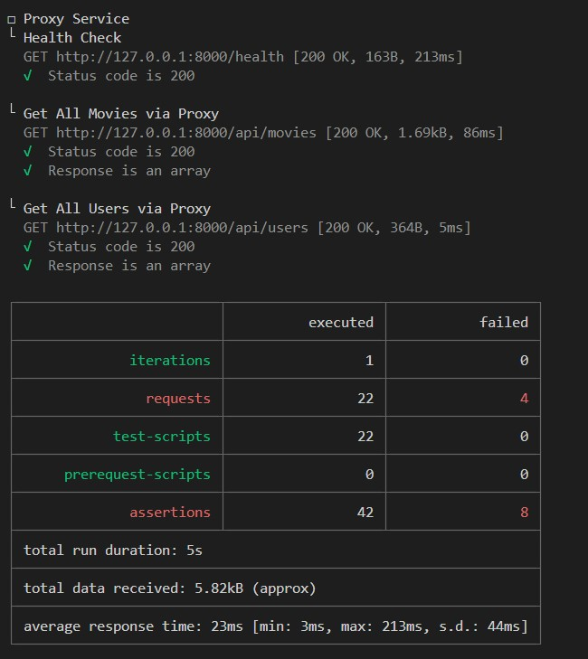
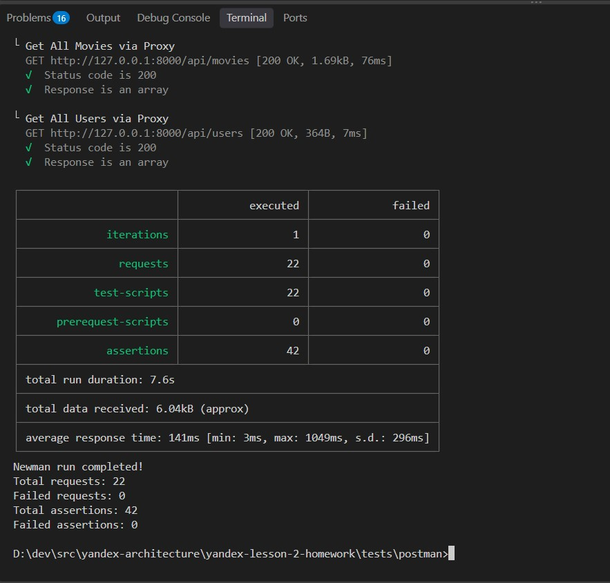
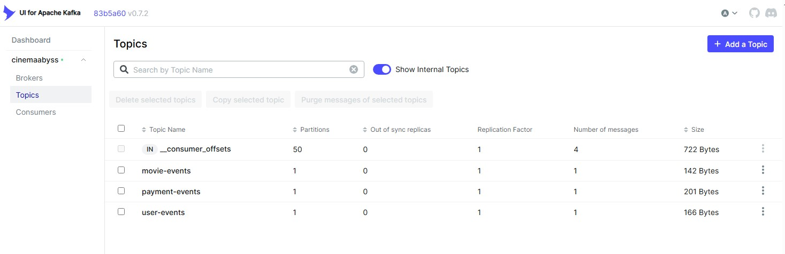
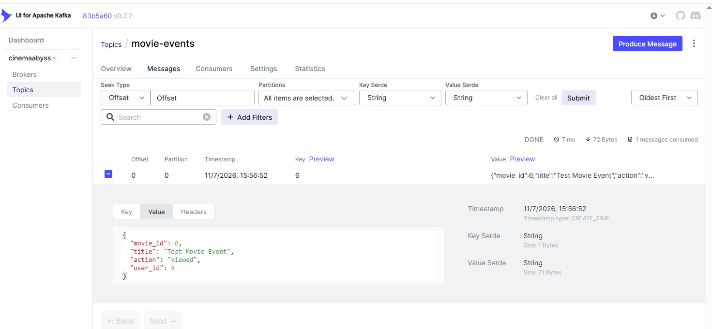
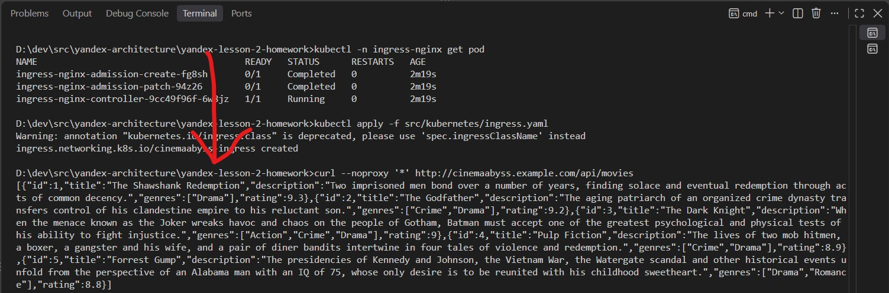
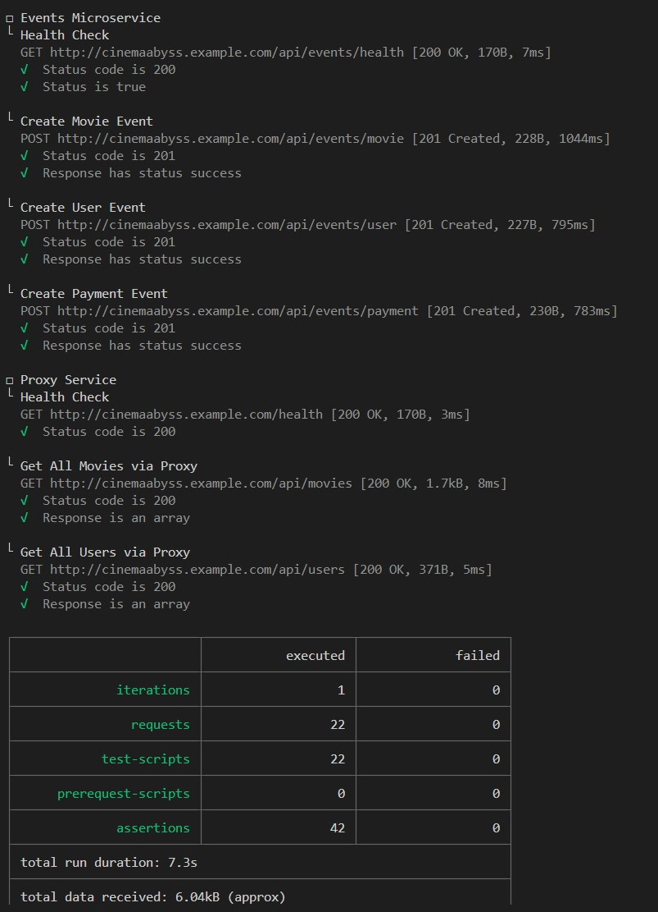

## Изучите [README.md](.\README.md) файл и структуру проекта.

# Задание 1

1. Контейнерная диаграмма

```plantuml
!include ./docs/Containers.puml
```

# Задание 2

### 1. Proxy

Реализовал и отладил сервис `proxy` на C# .NET Core 10.0 в `./src/microservices/proxy`.

1. Протестировал переключение траффика вручную через коллекцию Postman и через `curl http://localhost:8000/api/movies` - всё работает.
2. Добился прохождения всех Postman тестов через `npm test`, кроме events.
3. Протестировал распределение траффика, меняя переменную окружения MOVIES_MIGRATION_PERCENT в файле `docker-compose.yml`.

#### Скриншот тестов



### 2. Kafka

Реализовал и отладил сервис `events` на C# .NET Core 10.0 в `./src/microservices/events`.

1. Добился прохождения всех Postman тестов через `npm test`.

#### Скриншот тестов



#### Скриншот состояния топиков Kafka из UI `http://localhost:8090`



#### Содержимое топика `movie-events` из UI `http://localhost:8090`



# Задание 3

Команда начала переезд в Kubernetes для лучшего масштабирования и повышения надежности.
Вам, как архитектору осталось самое сложное:

- реализовать CI/CD для сборки прокси сервиса
- реализовать необходимые конфигурационные файлы для переключения трафика.

### CI/CD

- В папке .github/worflows доработал деплой новых сервисов proxy и events в docker-build-push.yml, чтобы api-tests при сборке отрабатывали корректно при отправке коммита.
- Добился "зеленой" сборка и "зеленых" тестов.

### Proxy в Kubernetes

#### Шаг 1

Для деплоя в kubernetes необходимо залогиниться в docker registry Github'а.

Создайте Personal Access Token (PAT) https://github.com/settings/tokens с правом read:packages

В src/kubernetes/\*.yaml (event-service, monolith, movies-service и proxy-service) отредактируйте путь до ваших образов

```bash
 spec:
      containers:
      - name: events-service
        image: ghcr.io/ваш логин/имя репозитория/events-service:latest
```

Добавьте в секрет src/kubernetes/dockerconfigsecret.yaml в поле

```bash
 .dockerconfigjson: значение в base64 файла ~/.docker/config.json
```

Если в ~/.docker/config.json нет значения для аутентификации

```json
{
        "auths": {
                "ghcr.io": {
                       тут пусто
                }
        }
}
```

то добавьте

```json
"auths": {
                "ghcr.io": {
                       "auth": "имя пользователя:токен в base64"
                }
        }
```

Чтобы получить значение в base64 можно выполнить команду

```bash
 echo -n ваш_логин:ваш_токен | base64
```

После заполнения config.json, также прогоните содержимое через base64

```bash
cat ~/.docker/config.json | base64
```

и полученное значение добавляем в

```bash
 .dockerconfigjson: значение в base64 файла ~/.docker/config.json
```

#### Шаг 2

Доработайте src/kubernetes/event-service.yaml и src/kubernetes/proxy-service.yaml

- Необходимо создать Deployment и Service
- Доработайте ingress.yaml, чтобы можно было с помощью тестов проверить создание событий
- Выполните дальшейшие шаги для поднятия кластера:

Создайте кластер

```bash
minikube start --driver=docker
```

Проверьте `kubectl get nodes`. Нода должна иметь STATUS `Ready`

Создайте namespace:

```bash
kubectl apply -f src/kubernetes/namespace.yaml
```

Создайте секреты и переменные

```bash
kubectl apply -f src/kubernetes/configmap.yaml
kubectl apply -f src/kubernetes/secret.yaml
kubectl apply -f src/kubernetes/dockerconfigsecret.yaml
kubectl apply -f src/kubernetes/postgres-init-configmap.yaml
```

Разверните базу данных:

```bash
kubectl apply -f src/kubernetes/postgres.yaml
kubectl -n cinemaabyss get pod          # ждём когда postgres-0 перейдет в STATUS `Running`
```

Разверните Kafka (вместе с Zookeeper)

```bash
kubectl apply -f src/kubernetes/kafka/kafka.yaml
```

Проверьте с помощью `kubectl -n cinemaabyss get pod`, теперь должно быть запущено 3 пода.

- kafka-0
- postgres-0
- zookeeper-0

Если не так, то посмотрите логи

```bash
kubectl -n cinemaabyss logs имя_пода (например - kafka-0)
```

Разверните монолит:

```bash
kubectl apply -f src/kubernetes/monolith.yaml
```

Разверните микросервисы:

```bash
kubectl apply -f src/kubernetes/movies-service.yaml
kubectl apply -f src/kubernetes/events-service.yaml
```

Разверните прокси-сервис:

```bash
kubectl apply -f src/kubernetes/proxy-service.yaml
```

Посмотрите статус всех подов

```bash
kubectl -n cinemaabyss get pod
```

все поды должны быть **Running**

```bash
  NAME                              READY   STATUS

  events-service-7587c6dfd5-6whzx   1/1     Running

  kafka-0                           1/1     Running

  monolith-8476598495-wmtmw         1/1     Running

  movies-service-6d5697c584-4qfqs   1/1     Running

  postgres-0                        1/1     Running

  proxy-service-577d6c549b-6qfcv    1/1     Running

  zookeeper-0                       1/1     Running
```

Добавим Ingress

- Добавьте аддон Ingress

```bash
minikube addons enable ingress
kubectl apply -f src/kubernetes/ingress.yaml
```

Если ingress.yaml отклонён с ошибкой, подождите минуту, пока поднимется ingress-контроллер.
Проверьте статус Ingress:

```bash
kubectl -n ingress-nginx get pod
```

Добавьте **под Админом** в C:\Windows\System32\drivers\etc\hosts

```bash
127.0.0.1 cinemaabyss.example.com
```

В отдельном окне **под Админом** запустите

```bash
minikube tunnel
```

Вызовите https://cinemaabyss.example.com/api/movies или

```bash
curl --noproxy '*' http://cinemaabyss.example.com/api/movies
```

Вы должны увидеть вывод списка фильмов.
Можно поэкспериментировать со значением MOVIES_MIGRATION_PERCENT в src/kubernetes/configmap.yaml и убедиться, что вызовы movies уходят полностью в новый сервис

Запустите тесты из папки tests/postman

```bash
npm run test:kubernetes
```

Часть тестов с health-чек упадет, но создание событий отработает.
Откройте логи event-service и сделайте скриншот обработки событий

#### Шаг 3

Скриншот вызова https://cinemaabyss.example.com/api/movies



Скриншот вывода event-service после вызова тестов



# Задание 4

Для простоты дальнейшего обновления и развертывания вам как архитектору необходимо так же реализовать helm-чарты для прокси-сервиса и проверить работу

Для этого:

1. Перейдите в директорию helm и отредактируйте файл values.yaml

```yaml
# Proxy service configuration
proxyService:
  enabled: true
  image:
    repository: ghcr.io/db-exp/cinemaabysstest/proxy-service
    tag: latest
    pullPolicy: Always
  replicas: 1
  resources:
    limits:
      cpu: 300m
      memory: 256Mi
    requests:
      cpu: 100m
      memory: 128Mi
  service:
    port: 80
    targetPort: 8000
    type: ClusterIP
```

- Вместо ghcr.io/db-exp/cinemaabysstest/proxy-service напишите свой путь до образа для всех сервисов
- для imagePullSecret проставьте свое значение (скопируйте из конфигурации kubernetes)
  ```yaml
  imagePullSecrets:
    dockerconfigjson: ewoJImF1dGhzIjogewoJCSJnaGNyLmlvIjogewoJCQkiYXV0aCI6ICJaR0l0Wlhod09tZG9jRjl2UTJocVZIa3dhMWhKVDIxWmFVZHJOV2hRUW10aFVXbFZSbTVaTjJRMFNYUjRZMWM9IgoJCX0KCX0sCgkiY3JlZHNTdG9yZSI6ICJkZXNrdG9wIiwKCSJjdXJyZW50Q29udGV4dCI6ICJkZXNrdG9wLWxpbnV4IiwKCSJwbHVnaW5zIjogewoJCSIteC1jbGktaGludHMiOiB7CgkJCSJlbmFibGVkIjogInRydWUiCgkJfQoJfSwKCSJmZWF0dXJlcyI6IHsKCQkiaG9va3MiOiAidHJ1ZSIKCX0KfQ==
  ```

2. В папке ./templates/services заполните шаблоны для proxy-service.yaml и events-service.yaml (опирайтесь на свою kubernetes конфигурацию - смысл helm'а сделать шаблоны для быстрого обновления и установки)

```yaml
template:
  metadata:
    labels:
      app: proxy-service
  spec:
    containers: Тут ваша конфигурация
```

3. Проверьте установку
   Сначала удалим установку руками

```bash
kubectl delete all --all -n cinemaabyss
kubectl delete  namespace cinemaabyss
```

Запустите

```bash
helm install cinemaabyss .\src\kubernetes\helm --namespace cinemaabyss --create-namespace
```

Если в процессе будет ошибка

```code
[2025-04-08 21:43:38,780] ERROR Fatal error during KafkaServer startup. Prepare to shutdown (kafka.server.KafkaServer)
kafka.common.InconsistentClusterIdException: The Cluster ID OkOjGPrdRimp8nkFohYkCw doesn't match stored clusterId Some(sbkcoiSiQV2h_mQpwy05zQ) in meta.properties. The broker is trying to join the wrong cluster. Configured zookeeper.connect may be wrong.
```

Проверьте развертывание:

```bash
kubectl get pods -n cinemaabyss
minikube tunnel
```

Потом вызовите
https://cinemaabyss.example.com/api/movies
и приложите скриншот развертывания helm и вывода https://cinemaabyss.example.com/api/movies

## Удаляем все

```bash
kubectl delete all --all -n cinemaabyss
kubectl delete namespace cinemaabyss
```
